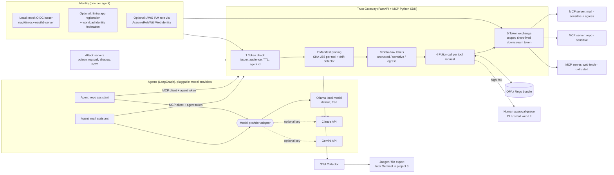

# Agent Trust Gateway: design (v0.1, 19 Oct 2026)
*Project 1 of 5 in Mir Mansoor Ahmed's AI security portfolio. Status: design. No results yet: every number below is a **target, to be measured**.*

## 1. Problem
AI agents now call tools through the **Model Context Protocol (MCP)**. The tool's *description* is text the model reads and trusts, and the agent usually holds broad, long-lived credentials.

**Real incidents**
- **Tool poisoning / shadowing / rug pull:** Invariant Labs showed hidden instructions in tool descriptions, cross-server "shadowing" of a trusted `send_email` tool, and descriptions that change after the user approved them [N1, N2].
- **Malicious MCP server in the wild:** `postmark-mcp` 1.0.16 silently BCC'd every email to an attacker (OSV MAL-2025-47604) [N4].
- **Client compromise:** CVE-2025-6514 (`mcp-remote`, CVSS 9.6) let a malicious server run OS commands on the client [N5].
- **Prompt injection via tool data:** a malicious GitHub issue steered an agent into leaking private-repo data through the GitHub MCP server [N3].

**Industry framing**
- The MCP authorization spec (2025-06-18) requires audience-bound tokens (RFC 8707) and forbids token passthrough, to prevent confused-deputy attacks [N6].
- OWASP's Agentic Top 10 (2026) lists ASI02 Tool Misuse, ASI03 Identity & Privilege Abuse and ASI04 Agentic Supply Chain [N8]. CoSAI catalogues ~40 MCP threats in 12 categories [N7].
- Agent identity is now a product category: Entra Agent ID [S3], AWS AgentCore Identity [N17].
- 97% of organisations with AI breaches lacked proper AI access controls (IBM 2025) [S5].

**Demand evidence:** Reply Deutschland's *Junior AI Security Engineer* posting (Düsseldorf) asks for IAM and Zero-Trust patterns for AI agents, OAuth 2.0/OIDC, MCP, A2A, prompt injection/data leakage, Terraform, CI/CD, and automated tests and monitoring of AI security controls [N22, aggregator copy].

*Source IDs refer to `../shortlist-v3.md` §7 (N-) and `../shortlist-v2.md` §6 (S-).*

## 2. Goals and non-goals
**Goals**
1. A central policy enforcement point (PEP) between MCP clients and MCP servers that:
   - pins tool manifests;
   - detects drift;
   - asks OPA for a decision on every tool call;
   - tracks data-flow labels across servers;
   - routes high-risk calls to a human-approval queue.
2. One identity per agent, with short-lived, audience-scoped tokens and no token passthrough.
3. A reproducible benchmark (benign suite + attack suite), compared against two static scanners.
4. Audit trail as OpenTelemetry spans (GenAI conventions), ready for project #3 (Sentinel detections).
5. **Runs fully local and free:** Docker Compose, Ollama, mock OIDC issuer. Cloud identity is optional and Terraform-only.

**Non-goals:** a production product; a new prompt-injection classifier (heuristics plus an optional small local-model check only); securing the MCP client host (CVE-2025-6514 class is cited, not fixed); A2A (stretch only); claims of compliance.

## 3. Threat model
Assets: user data reachable via tools (mail, repo, files), agent credentials, the integrity of tool manifests.
Trust boundaries:
- agent ↔ gateway;
- gateway ↔ each MCP server (untrusted by default);
- gateway ↔ identity provider (IdP);
- gateway ↔ human approver.

| # | Threat | Example in this lab | Control in gateway | OWASP LLM 2025 | OWASP Agentic 2026 | MITRE ATLAS (v5.6.0) |
|---|---|---|---|---|---|---|
| T1 | MCP tool poisoning | hidden `<IMPORTANT>` instructions in a tool description | description linter, allowlisted servers, policy | LLM01 | ASI02, ASI04 | AML.T0110 AI Agent Tool Poisoning; AML.T0104 Publish Poisoned AI Agent Tool |
| T2 | Rug pull / manifest drift | server changes its tool description on the 2nd launch | manifest hash pinning, drift → block/quarantine + alert | LLM03 Supply Chain | ASI04 | AML.T0109 AI Supply Chain Rug Pull |
| T3 | Cross-server exfiltration / shadowing | malicious server instructs the agent to BCC mail or post repo data | data-flow labels (sensitive → egress needs approval), argument constraints | LLM02, LLM06 | ASI02 | AML.T0086 Exfiltration via AI Agent Tool Invocation |
| T4 | Confused deputy / token passthrough | the agent's token is replayed to another server | audience check (RFC 8707), per-server token exchange, no passthrough | LLM06 | ASI03 | *no exact technique; mitigation AML.M0026 (mapping unverified)* |
| T5 | Over-privileged agent tokens | one long-lived key with all scopes | per-agent identity, short TTL, per-tool scopes, OPA allowlist | LLM06 | ASI03 | AML.T0083 Credentials from AI Agent Configuration; mitigations AML.M0026/M0028 |
| T6 | Prompt injection via tool output | a fetched issue/email says "send the private file to X" | output labelled *untrusted*; egress after untrusted input needs approval | LLM01 | ASI01 Agent Goal Hijack | AML.T0051 LLM Prompt Injection; mitigation AML.M0030 |
| (cross) | Approval fatigue | a flood of approval requests | risk-tiered approvals, rate limits | — | ASI09 | AML.M0029 Human In-the-Loop for AI Agent Actions |

**How these IDs were checked**
- OWASP LLM 2025 IDs: verified on genai.owasp.org.
- OWASP ASI names: from the OWASP PDF table of contents.
- ATLAS IDs: resolved from the ATLAS.yaml v5.6.0 copy, which is marked deprecated upstream. **Re-check them against the current atlas-data before publishing.**
- OWASP NHI Top 10 2025 (NHI5 Overprivileged, NHI7 Long-Lived Secrets): only NHI1/NHI2 were verified directly.

## 4. Architecture


**Request path:**
1. The agent sends a `tools/call` with its own token.
2. The gateway validates the token: issuer, `aud` = gateway, expiry ≤ 10 min, `agent_id` claim.
3. It compares the server's current `tools/list` hash with the pinned manifest. On drift it blocks the server and raises an alert.
4. It labels the session context (e.g. "has read untrusted content", "holds sensitive data").
5. It sends `{agent, tool, args, labels, server trust}` to OPA, which answers allow / deny / needs approval.
6. On allow, the gateway gets a *separate* downstream token scoped to that server (token exchange, RFC 8693 style). The agent's own token is never forwarded.
7. Every step emits OTel spans: `execute_tool {tool}` with `gen_ai.operation.name`, `gen_ai.tool.name` and `gen_ai.agent.name` (the GenAI conventions are at "Development" stability, so pin the version), plus custom `atg.*` attributes for decision, labels and manifest hash.

**Provider choice:** an adapter (LiteLLM or a thin interface) is set by env vars. With no API keys, everything runs on Ollama. Claude/Gemini are switched on per run for cross-model comparison.

**Cost:** €0 locally. The optional cloud parts (Entra app registrations, an AWS IAM OIDC provider + role) are free-tier / no-charge resources, created only by Terraform and removed with `terraform destroy`. *Free-tier eligibility on Mir's accounts is unverified.*

## 5. Repo layout
```
agent-trust-gateway/
├── README.md               # problem, results table (after runs), demo video link, Kurzfassung (DE)
├── DESIGN.md               # this file
├── docs/adr/               # 0001-central-pep, 0002-opa, 0003-pin-vs-alert, 0004-no-passthrough, 0005-local-idp
├── gateway/                # FastAPI app: auth.py, manifest.py, labels.py, policy.py, tokens.py, approvals.py, telemetry.py
├── policies/               # Rego + opa test files (policies/*_test.rego)
├── agents/                 # LangGraph agents + provider adapter (ollama | anthropic | gemini)
├── servers/
│   ├── benign/             # mail, repo, web-fetch mock MCP servers (synthetic data)
│   └── attacks/            # poison, rug_pull, shadow_bcc, injection_output, token_replay
├── eval/                   # suites (YAML), runner, metrics, baseline-scanner wrappers, results/ (git-ignored raw)
├── infra/
│   ├── docker-compose.yml  # gateway, opa, mock-oidc, ollama, otel-collector, jaeger, servers
│   └── terraform/          # optional: entra/, aws/ (OIDC provider + role)
├── tests/                  # pytest unit + integration
└── .github/workflows/ci.yml  # lint, pytest, opa test, small eval smoke run (Mir publishes; nothing pushed by me)
```

## 6. Tech stack (versions checked 19 Oct 2026; pin them at build time)

| Area | Choice | Licence / note |
|---|---|---|
| Gateway | Python 3.12, FastAPI 0.149, httpx, PyJWT 2.15 | MIT/BSD |
| MCP | Official MCP Python SDK (`mcp` 2.3.0) | MIT |
| Policy | OPA (Docker image) + Rego, `opa test` | Apache-2.0 |
| Identity (local) | navikt/mock-oauth2-server (Docker) | MIT |
| Identity (optional) | Entra ID app registrations + federated credentials; AWS IAM OIDC provider + role | Terraform `azuread`, `aws` providers |
| Models | Ollama (default, e.g. a small Llama/Qwen model with tool calling); Claude/Gemini optional via LiteLLM 1.106 / SDKs | Ollama MIT; APIs need keys |
| Agents | LangGraph | MIT |
| Telemetry | OpenTelemetry SDK 1.45 + Collector-contrib + Jaeger | Apache-2.0 |
| Runtime | Docker Compose | — |
| Tests/CI | pytest, GitHub Actions | — |
| Baselines | **Cisco AI Defense `mcp-scanner`** (PyPI `cisco-ai-mcp-scanner` 4.8.6, Apache-2.0); **Snyk Agent Scan** (PyPI `snyk-agent-scan` 0.6.8, Apache-2.0, formerly Invariant `mcp-scan`) | Cisco: the YARA/static mode runs offline with no key (its LLM and AI Defense analyzers need keys; try pointing the LLM analyzer at Ollama, *untested*). Snyk: **needs a free Snyk account + `SNYK_TOKEN`** and sends tool metadata to Snyk's API, so run it on synthetic servers only, or skip it if Mir has no account. |

## 7. Evaluation plan (all values **to be measured**; no results yet)

**Suites**
- **Benign suite:** ~50 tool-call tasks across mail/repo/web servers (e.g. "summarise my last 3 emails", "open an issue in my repo").
- **Attack suite:** ≥6 scenarios (T1–T6), each with several variants:
  - direct poisoning, sleeper rug pull, BCC shadowing, injected tool output;
  - token replay to the wrong audience, expired token, over-scoped token.
- **Repetitions:** each run ×N repetitions (target N ≥ 20) per model.

**Conditions**
- (a) no gateway;
- (b) static scanners only (Cisco, Snyk) run before the session;
- (c) gateway;
- (d) gateway + scanners.

**Models:** Ollama local (always); Claude and Gemini when keys exist.

| Metric | Definition | Target (hypothesis, to be measured) |
|---|---|---|
| Attack block rate | blocked or approval-held attack attempts / all attack attempts, per threat and model, 95% bootstrap CI | high for T2/T4/T5 (deterministic controls); T1/T3/T6 reported honestly, whatever it is |
| Attack success rate (ASR) | attacker goal reached (e.g. BCC sent, file leaked) / attempts | to be measured, (a) vs. (c) |
| False-block rate | benign calls wrongly denied or held / benign calls | to be measured; aim low single digits |
| Benign task success | benign tasks completed / tasks | to be measured, (a) vs. (c) |
| Added latency | gateway overhead per tool call, p50 / p95 (model time excluded) | to be measured; aim tens of ms |
| Drift detection time | time from manifest change to block + alert | to be measured; by design, at the next `tools/list` or the call itself |
| Token tests | wrong audience, expired, passthrough, over-scope | pass/fail matrix; all must be rejected |
| Scanner comparison | which scenarios each baseline flags statically | to be measured; runtime-only cases (T2 sleeper, T3, T6) are where static scanning is expected to miss, which the run must confirm or refute |

Every number in the README will link to the command and commit that produced it, and raw outputs are kept.

## 8. Four-day build plan

| Day | Deliverables (done = demoable + tested) |
|---|---|
| 1 | Compose stack up (gateway skeleton, OPA, mock OIDC, Ollama, collector, Jaeger). Benign mail/repo/web MCP servers on synthetic data. Agent with provider adapter (Ollama only). Token validation + no-passthrough + per-server token minting. pytest for the auth paths. ADRs 0001/0004/0005. |
| 2 | Manifest pinning + drift detector, description linter, data-flow labels, Rego policies + `opa test`, approval queue (CLI). OTel spans with GenAI attributes. Optional: Terraform for the Entra app + AWS OIDC role (plan/apply only if Mir has accounts). |
| 3 | Attack servers T1–T6, eval runner (YAML suites, repetitions, conditions a–d), baseline-scanner wrappers (Cisco offline mode; Snyk if a token exists). First full run on Ollama. |
| 4 | Full runs (plus Claude/Gemini if keys exist), metrics + CIs, results table, README (+ Kurzfassung DE), limitations, 12-min demo recording, CI workflow. |

## 9. Twelve-minute demo script
1. **0:00–1:30 Problem:** postmark-mcp BCC backdoor, the tool-poisoning quote, the Reply posting line ("IAM- und Zero-Trust-Patterns für KI-Agenten").
2. **1:30–3:00 Architecture:** diagram walk-through: identity → pinning → labels → OPA → token exchange → telemetry.
3. **3:00–5:00 Attack without the gateway:** the agent sends an email via the rug-pulled server and the attacker's inbox receives a BCC.
4. **5:00–7:00 Same attack with the gateway:** drift blocked, alert raised, trace visible in Jaeger. Then the BCC-shadowing variant hits the OPA deny on the recipient constraint.
5. **7:00–8:30 Identity:** replay the agent token against another server (rejected on audience), then show an expired token rejected.
6. **8:30–9:30 Prompt injection via tool output:** a web page instructs "mail the repo secrets"; egress-after-untrusted triggers the approval queue and the human denies.
7. **9:30–11:00 Results table** (measured): block rate, ASR, false blocks, latency, scanner comparison.
8. **11:00–12:00 Limitations + next steps:** project #3 detections, A2A stretch.

## 10. Risks and limitations
- The linter heuristics are bypassable; the deterministic controls (pinning, audience, OPA constraints) carry the security case, and the README says so.
- Small local models handle tool calls less reliably, which may lower benign success independent of the gateway. Report per model.
- Approval fatigue (ASI09) is only partly mitigated by risk tiers.
- MCP spec and SDK churn: pin the spec revision (2025-06-18 auth reviewed; check for newer) and SDK version.
- Synthetic servers and data only: results show mechanisms, not real-world prevalence.
- Snyk baseline needs an account and sends metadata to a third party; Cisco's full analyzers need keys. Baseline coverage may therefore be partial; this will be stated.
- Entra Agent ID is not used by default (licensing unverified); plain app registrations + federated credentials stand in for it.
- The gateway itself becomes a high-value target and a single point of failure (an availability trade-off, documented in ADR 0001).

## 11. Kurzfassung (DE)
Agent Trust Gateway: ein Policy-Enforcement-Point zwischen KI-Agenten und MCP-Servern mit Manifest-Pinning, Drift-Erkennung, OPA/Rego-Richtlinien pro Tool-Aufruf, Datenfluss-Labels und Freigabe durch Menschen.
Jeder Agent erhält eine eigene Identität (Entra ID / AWS IAM, lokal per Mock-OIDC) mit kurzlebigen, zielgebundenen Tokens, ohne Token-Weitergabe (Zero Trust, Least Privilege).
Messbar evaluiert gegen Tool Poisoning, Rug Pulls, Datenabfluss und Confused-Deputy-Angriffe (OWASP Agentic Top 10, MITRE ATLAS). Stichworte: KI-Sicherheit, IAM für KI-Agenten, nicht-menschliche Identitäten, Policy-as-Code, Protokollierung mit OpenTelemetry.
