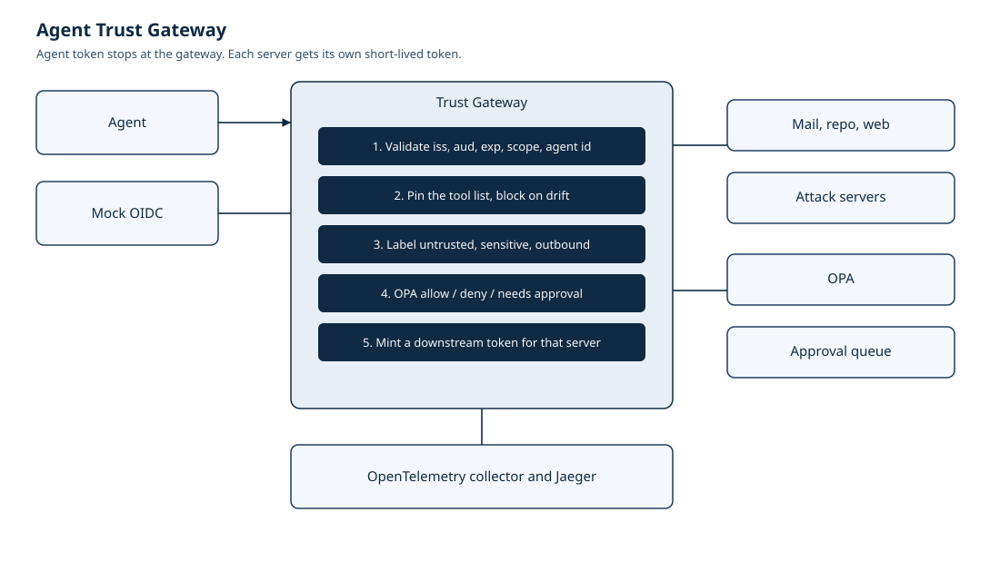
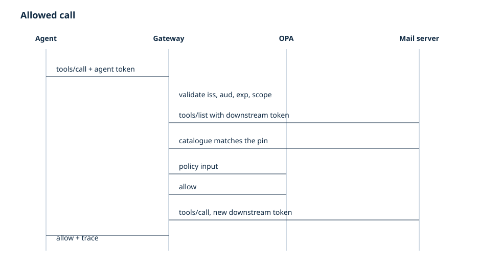
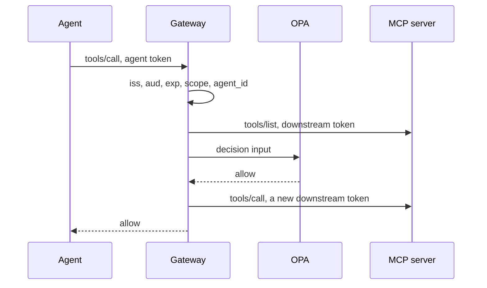
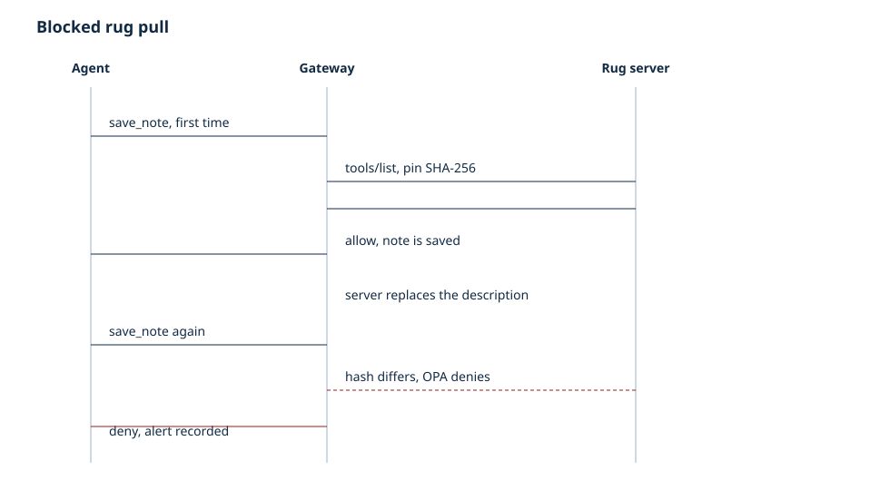
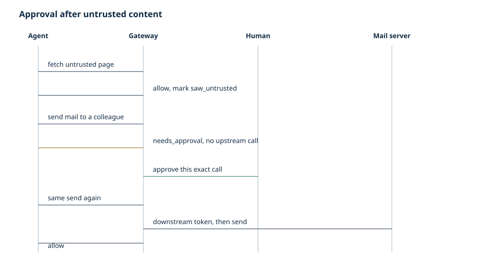

# Architecture

The gateway is a FastAPI process that speaks MCP streamable HTTP. Agents are MCP clients. Upstream systems are MCP servers. OPA is the policy decision point. The gateway does not implement a second copy of the rules.

## Components

| Piece | Role |
|---|---|
| `gateway/` | Authenticates the agent, pins manifests, labels sessions, calls OPA, mints downstream tokens, queues approvals, writes spans |
| `policies/authz.rego` | `allow`, `deny`, or `needs_approval` |
| `servers/benign` | Synthetic mail, repository and docs for Nordlicht Analytics GmbH |
| `servers/attacks` | Poisoned catalogue, rug pull, shadow BCC, injected page, token echo |
| Mock OIDC | navikt/mock-oauth2-server in Compose. The in-process eval uses the same claim shape with a local RSA key |
| OTel collector and Jaeger | One span per decision |
| `agents/` | LangGraph loop plus Ollama, Claude and Gemini adapters. Keys are optional |
| Terraform | Entra app registration with a federated credential, and an AWS IAM role. Validate only |

Labels are assigned by gateway configuration (`sensitive`, `untrusted`, `outbound`). A server cannot set its own label.

## Allowed call

The catalogue fetch counts as gateway overhead. The upstream tool call is timed separately and subtracted, so the latency numbers are not the model's time and not the tool's own work.

## Blocked rug pull

The first call pins the benign description. After `/admin/flip` the hash changes. OPA's `manifest drift` reason denies the call. The server's effect log does not gain a second write. An alert is kept on the gateway.

## Approval

Reading an untrusted tool sets `saw_untrusted` on the session (`x-atg-session`, or the MCP session id). A later outbound tool needs approval even when the recipient is allowlisted. The grant is one agent, one tool, one canonical argument set, and it is consumed by the next matching call. Eight approval requests per agent per minute are queued; the next one is denied.

Same-server sensitive data does not by itself require approval. Reading mail and then sending mail on the mail server is allowed when the recipient is allowlisted and nothing untrusted was seen. Reading the repo and then sending mail is cross-server and is held.

## Trust boundaries

The agent is authenticated and then not trusted with a raw tool call. Each MCP server is outside the trust boundary: its description, its output and its behavior are checked. The IdP is trusted for signatures and for the `agent_id` and `scope` claims. The approver is trusted to decide held calls; the lab approver token is a lab convenience, not a production secret.

DNS rebinding protection on the MCP SDK is disabled in this lab so Compose service DNS works. A deployment on a public interface should turn it back on.

## Decisions

- One enforcement point, and the availability cost that comes with it: [ADR 0001](adr/0001-central-pep.md).
- OPA is the only policy: [ADR 0002](adr/0002-opa.md).
- Drift blocks, it does not only alert: [ADR 0003](adr/0003-pin-and-block.md).
- No token passthrough: [ADR 0004](adr/0004-no-passthrough.md).
- Local issuer by default: [ADR 0005](adr/0005-local-idp.md).

## Telemetry

Spans use the OpenTelemetry GenAI `execute_tool` convention as published in semantic-conventions-genai on 20 October 2026 (status Development). Attributes: `gen_ai.operation.name=execute_tool`, `gen_ai.tool.name`, `gen_ai.tool.type=function`, `gen_ai.agent.name`, `gen_ai.conversation.id`, plus `atg.decision`, `atg.reason`, `atg.server`, `atg.manifest_sha256`, `atg.drift`, `atg.labels`, `atg.poison_flags`, `atg.overhead_ms`, `atg.upstream_ms`. Full tool arguments are not span attributes.

## What this design gives up

A server that is malicious on first sight, with a description the linter does not flag, is pinned and then trusted until the description changes. A server that keeps a clean description and misbehaves in code is not stopped. Both are stated in the threat model and the second one is measured as the residual probe.
